  <a href="https://github.com/cosmincraciun97">
    <picture>
      <source media="(prefers-color-scheme: dark)" srcset="./assets/header-dark.svg">
      <source media="(prefers-color-scheme: light)" srcset="./assets/header-light.svg">
      
    </picture>
  </a>

  <a href="https://sidewhisper.app"><picture><source media="(prefers-color-scheme: dark)" srcset="./assets/link-web-dark.svg"></picture></a>&nbsp;
  <a href="https://www.linkedin.com/in/cosmincraciun"><picture><source media="(prefers-color-scheme: dark)" srcset="./assets/link-linkedin-dark.svg"></picture></a>&nbsp;
  <a href="https://x.com/CosminCraciun12"><picture><source media="(prefers-color-scheme: dark)" srcset="./assets/link-x-dark.svg"></picture></a>

I'm Cosmin, a software developer from Bucharest. Most of my time goes into [Side Whisper](https://sidewhisper.app), a sidebar for Windows where you keep the web apps you use all day. The rest goes into [Stonewright](https://github.com/cosmincraciun97/stonewright-wp-mcp), an open-source WordPress plugin for AI agents. It takes a snapshot before every change, so anything they do can be rolled back.

### What I'm working on

  <a href="https://sidewhisper.app">
    <picture>
      <source media="(prefers-color-scheme: dark)" srcset="./assets/card-sidewhisper-dark.svg">
      <source media="(prefers-color-scheme: light)" srcset="./assets/card-sidewhisper-light.svg">
      
    </picture>
  </a>

  <a href="https://github.com/cosmincraciun97/stonewright-wp-mcp">
    <picture>
      <source media="(prefers-color-scheme: dark)" srcset="./assets/card-stonewright-dark.svg">
      <source media="(prefers-color-scheme: light)" srcset="./assets/card-stonewright-light.svg">
      
    </picture>
  </a>

### Stack

  <picture>
    <source media="(prefers-color-scheme: dark)" srcset="./assets/stack-dark.svg">
    <source media="(prefers-color-scheme: light)" srcset="./assets/stack-light.svg">
    
  </picture>

Easiest way to reach me is <a href="https://x.com/CosminCraciun12">X</a> or <a href="https://www.linkedin.com/in/cosmincraciun">LinkedIn</a>.
